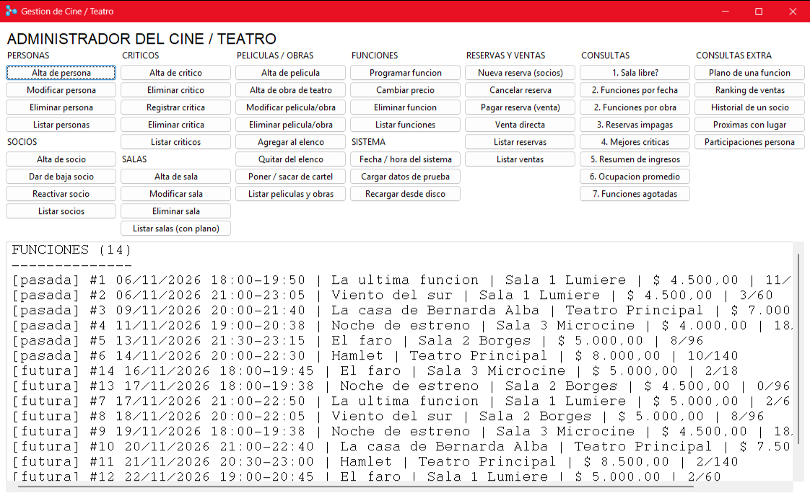
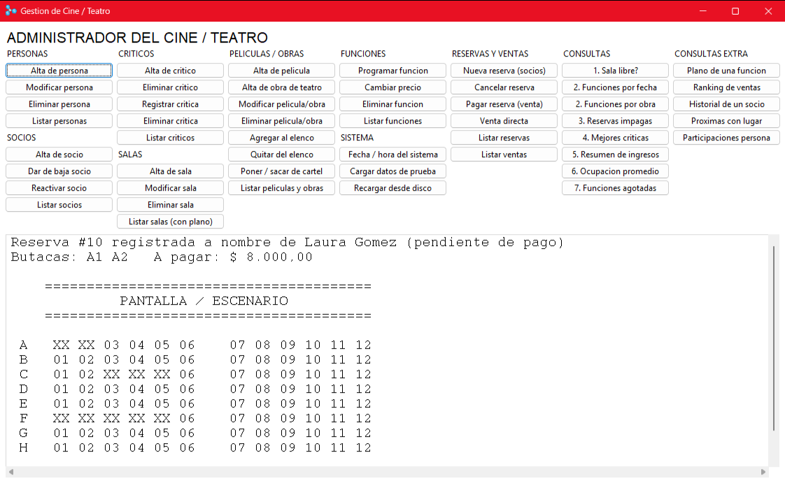
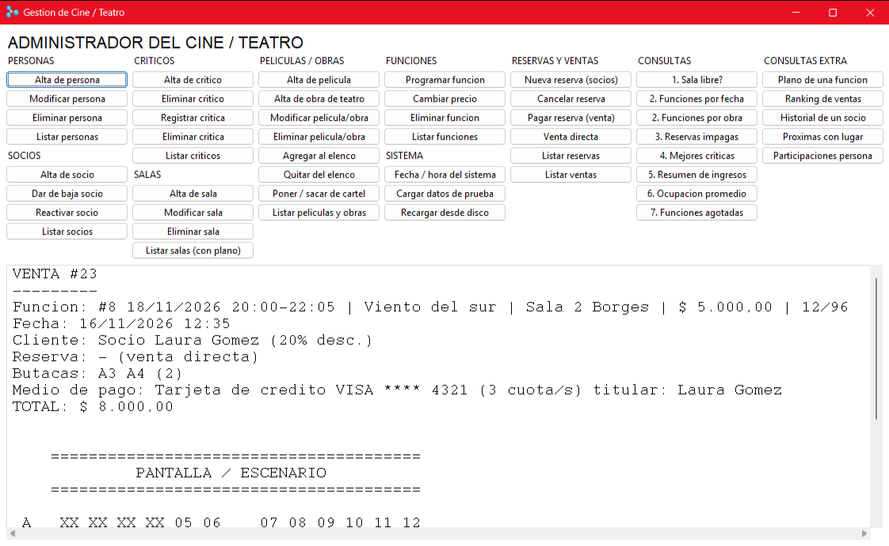
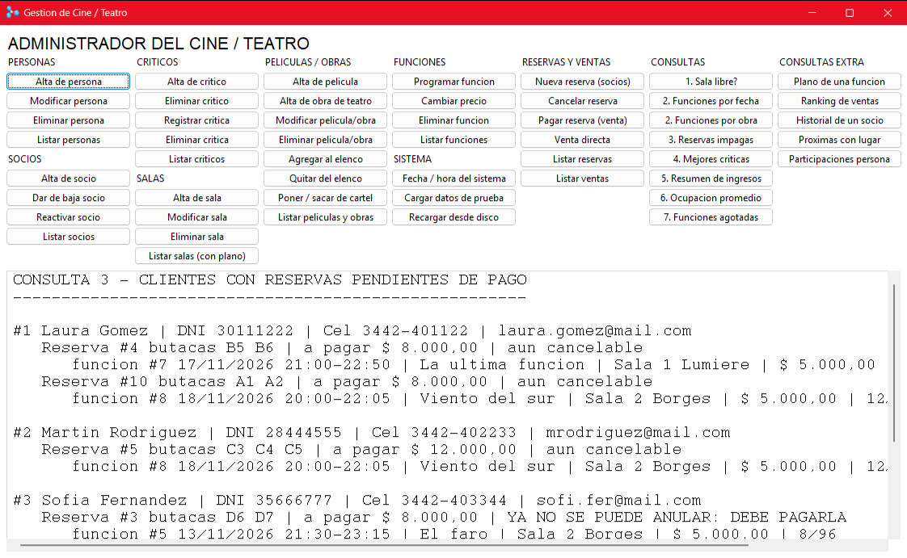
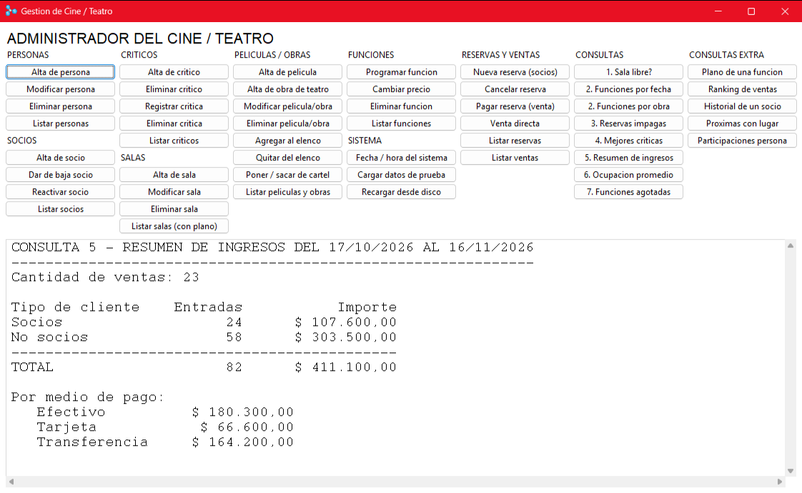
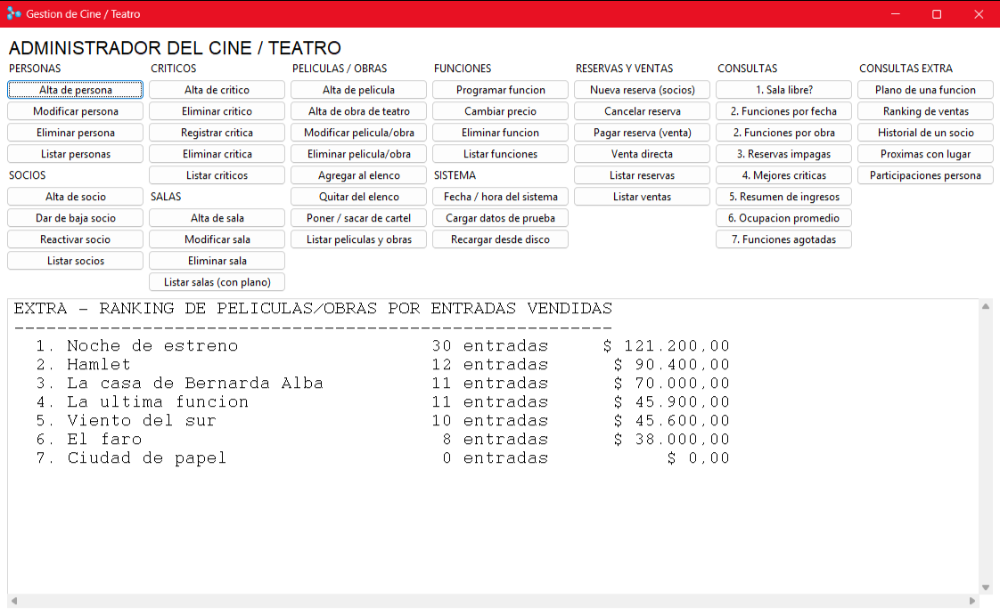

# Proyecto Paradigmas de Programación 2025 – Gestión de un Cine/Teatro

Implementado en **Smalltalk (VisualWorks 8.2)**. El sistema es un solo paquete, `CineTeatro`; las pruebas automáticas están en otro, `CineTeatro-Tests`.



> **Para estudiar el código y preparar la defensa: [docs/GUIA.md](docs/GUIA.md).** Explica la sintaxis, cada clase, qué pasa al apretar cada botón, la persistencia, la interfaz y las preguntas típicas.

## Contenido del repositorio

| Archivo | Qué es |
|---|---|
| `src/CineTeatro.st` | Código fuente completo (file-out XML de VisualWorks): 25 clases, 549 métodos |
| `src/CineTeatro-Tests.st` | Pruebas automáticas con SUnitToo: 226 pruebas en 10 clases |
| `tests/correr-pruebas.st` | Script que carga todo en una imagen limpia, corre las pruebas y escribe `tests/resultado.txt` |
| `datosCine/*.bos` | Datos de prueba ya cargados, una lista por archivo (personas, socios, criticos, obras, salas, funciones) |
| `docs/GUIA.md` | Guía para entender el código |
| `docs/capturas/` | Capturas del sistema funcionando |

## Cómo cargarlo y abrirlo

1. Abrí VisualWorks 8.2 y, desde el Launcher, abrí un **Workspace**.
2. Cargá el código evaluando esta línea (seleccionala y elegí *Do it*). Ajustá la ruta si hace falta:
   ```smalltalk
   'C:\ruta\al\repo\src\CineTeatro.st' asFilename fileIn.
   ```
   También podés hacerlo desde el *File Browser*: seleccionás el archivo y elegís *File In*.
3. Abrí la interfaz:
   ```smalltalk
   VentanaCine open.
   ```
4. La pantalla de bienvenida muestra **la ruta exacta de la carpeta `datosCine`** que usa el sistema. Es relativa al directorio de trabajo de la imagen.
   - Si querés usar los datos de prueba incluidos, copiá la carpeta `datosCine` a esa ruta y presioná **Recargar desde disco**.
   - O simplemente presioná **Cargar datos de prueba**: genera todo de nuevo, con fechas relativas al día de hoy. Es lo recomendable antes de cada demostración.
5. Guardá la imagen (*File > Save Image*) para no tener que volver a hacer el *File In*.

Todos los cambios se graban solos en disco después de cada operación.

La ventana mide 1122 × 660: entra en una pantalla de 1366 × 768. Se puede agrandar o maximizar; el panel de resultados crece con ella.

## Cómo correr las pruebas

Desde PowerShell, parado en la carpeta del repositorio (no abre ninguna ventana; tarda alrededor de un minuto):

```powershell
$env:VISUALWORKS = 'C:\Program Files (x86)\Cincom\vw8.2pul'
Copy-Item "$env:VISUALWORKS\image\visualnc64.im" trabajo.im
& "$env:VISUALWORKS\bin\win64\vwntconsole.exe" trabajo.im -nogui -filein tests\correr-pruebas.st
Get-Content tests\resultado.txt
```

Ajustá la primera línea si VisualWorks está instalado en otra carpeta. El script carga SUnitToo, `CineTeatro.st` y `CineTeatro-Tests.st` en una copia limpia de la imagen (`trabajo.im`, que git ignora), verifica que **todos los métodos compilen** y que no queden variables sin declarar, y corre las pruebas. El final de `tests/resultado.txt` tiene que decir:

```
TOTAL: 226 pruebas, 226 pasaron, 0 fallaron, 0 con error

RESULTADO: TODAS LAS PRUEBAS PASARON
```

Las pruebas trabajan en una carpeta temporal (`pruebasCineTmp`) y con el reloj simulado: **no tocan `datosCine`**. Los mensajes `No se pudo leer pruebasCineTmp\...` que aparecen en la consola son de las pruebas que dañan un archivo a propósito.

| Clase de pruebas | Cantidad | Qué cubre |
|---|---|---|
| `UtilCineTest` | 16 | Conversión de fechas, horas e importes; formatos |
| `PersonasTest` | 20 | Altas, bajas y modificaciones de personas, socios y críticos |
| `ObrasSalasTest` | 17 | Altas, bajas y modificaciones de películas, obras y salas; elenco; cartel |
| `FuncionesTest` | 15 | Programación de funciones y superposición de horarios (incluida la medianoche) |
| `ReservasVentasTest` | 24 | Reglas de reserva, 24 horas, función agotada, descuento, medios de pago |
| `EstadosReservaTest` | 11 | Los estados de una reserva (patrón State) |
| `DominioTest` | 16 | `Sala`, `Funcion`, `Reserva`, `Venta` y los medios de pago usados directamente |
| `ConsultasTest` | 16 | Las 7 consultas pedidas y las 5 agregadas |
| `PersistenciaTest` | 11 | Guardar, releer y archivos dañados |
| `VentanaCineTest` | 80 | Los 51 botones de la interfaz, con errores y cancelaciones (con diálogos simulados, sin abrir ventanas) |

Para cargarlas y correrlas desde adentro de VisualWorks, ver la [guía](docs/GUIA.md#7-las-pruebas-automáticas).

## Diseño

### Clases

| Clase | Responsabilidad |
|---|---|
| `AdministradorCine` | Clase central pedida por el enunciado. Gestión de personas, socios, críticos, obras, salas y funciones; consultas; persistencia; reloj del sistema. En las reservas y ventas coordina: busca los objetos, asigna los ids y guarda |
| `Persona` | id, nombre, dni, fechaNacimiento, sexo, domicilio, email, celular |
| `Socio` | id, idPersona, fechaAlta, estado (#activo/#inactivo). Sabe aplicar su 20% de descuento |
| `Critico` / `Critica` | Usuario crítico; reseña con puntaje de 1 a 10 |
| `ObraArtistica` (abstracta) → `Pelicula`, `ObraTeatro` | Se dividió como sugiere el enunciado. **Polimorfismo**: `tipo`, `puedePresentarseEn: unaSala`, `admiteCriticas`, `agregarCritica:` |
| `Sala` / `Butaca` | La sala genera sus butacas (fila letra + número, con posición X/Y y pasillo central), dibuja su plano y valida los códigos de butaca |
| `Funcion` | Obra + sala + fecha + hora + precio, con `listaReservas` y `listaVentas`. Calcula ocupación y superposición de horarios, pasa a **#agotada** sola, y es la que **reserva, cobra, cancela y vende** (principio Experto) |
| `Reserva` | Guarda el precio de la entrada al momento de reservar y sabe cuánto vale. Lo que depende de su estado se lo delega a un objeto estado |
| `EstadoReserva` (abstracta) → `ReservaPendiente`, `ReservaConfirmada`, `ReservaCancelada` | **Patrón State**: cada estado decide si la reserva se puede pagar o cancelar (regla de las 24 hs) y si sigue ocupando sus butacas |
| `Venta` | Directa (idReserva = nil) o desde una reserva; idSocio = nil si el comprador no es socio. Calcula el importe a cobrar (descuento y redondeo) |
| `MedioPago` (abstracta) → `PagoEfectivo`, `PagoTarjeta`, `PagoTransferencia` | Datos específicos de cada medio (tarjeta: tipo, marca, últimos 4, cuotas, titular; transferencia: alias y número de operación). Cada uno valida sus propios datos |
| `UtilCine` | Formatos y conversiones (fechas dd/mm/aaaa, horas hh:mm, moneda $ 1.234,50) |
| `ErrorCine` / `AccionCancelada` | Errores de negocio (la interfaz los muestra como aviso) y cancelación de un diálogo (la acción se abandona sin cambiar nada) |
| `VentanaCine` | Interfaz gráfica (ApplicationModel): botones por módulo, diálogos para cargar datos y panel de resultados |

### Operaciones de gestión

| Módulo | Alta | Modificación | Baja | Listado |
|---|---|---|---|---|
| Personas | sí | todos los datos, de a uno (el DNI no se puede repetir) | solo si no es ni fue socio, no es crítico y no participa en ninguna obra | sí, con el rol de cada una |
| Socios | sí | — | baja lógica (queda inactivo) y reactivación | sí |
| Críticos | sí | — | solo si no tiene críticas | sí |
| Críticas | sí (una por crítico y película) | registrar otra la reemplaza | sí | junto con las películas |
| Películas y obras | sí | título, descripción, duración, clasificación, director; elenco (agregar y quitar); poner y sacar de cartel | solo si no tiene funciones | sí |
| Salas | sí | nombre, butacas y tipos de obra | solo si no tiene funciones | sí, con el plano |
| Funciones | sí | precio | solo si no tiene reservas ni ventas | sí |
| Reservas | sí | — | cancelación (queda registrada) | sí |

Las bajas son restrictivas a propósito: nunca queda un id apuntando a algo que ya no existe.

### Decisiones y adaptaciones respecto del enunciado
- **Persistencia**: cada lista se guarda en su propio archivo con **BOSS** (`BinaryObjectStorage`), en la carpeta `datosCine`. Las reservas y ventas se guardan dentro de cada función (`listaReservas` / `listaVentas`), como pide la clase Función, para no duplicar datos.
- **Archivos dañados**: si un `.bos` existe pero no se puede leer, el sistema lo avisa en la pantalla de bienvenida y **no graba nada** hasta que se repare o quite el archivo y se use *Recargar desde disco* (o *Cargar datos de prueba* para empezar de cero). Así un archivo ilegible nunca se pisa con una lista vacía.
- **Importes exactos**: los precios se escriben a la manera local (`5000`, `5.000`, `4500,50`) y se guardan como enteros o fracciones, no como `Float`, para no perder centavos. Lo cobrado se redondea al centavo.
- Las relaciones se hacen por **id** (idPersona, idSala, idObra…), igual que en el enunciado.
- `Funcion` guarda su `capacidad` y su `duracion` al crearse, así puede saber sola si está agotada o si se superpone con otra.
- `Venta` tiene `idSocio` además de lo pedido: hace falta para el resumen de ingresos por tipo de cliente y para que un socio tenga su descuento también en compras directas.
- **Reloj simulado** (*Fecha / hora del sistema*): permite fijar una fecha y hora para demostrar la regla de las 24 hs, o vender en funciones "pasadas" al cargar datos.

### Reglas de negocio implementadas
- Solo los **socios activos** reservan. Las reservas se hacen sin pago y a nombre del socio.
- Una reserva se **cancela sin costo hasta 24 hs antes**. Después ya no se puede anular y figura como "DEBE PAGARLA".
- **20% de descuento** para socios en toda compra (con o sin reserva).
- Pagar una reserva genera la venta con las mismas butacas y deja la reserva **confirmada**.
- Una función no supera la capacidad de la sala. Con todas las butacas reservadas o vendidas pasa a **agotada**.
- Solo se programan funciones de obras **en cartel**, en salas que admiten ese tipo de obra, en el futuro y **sin superponerse** con otra función de la sala.
- Cada reserva guarda el **precio** de la entrada al momento de reservar y se cobra a ese precio: cambiar el precio de una función solo afecta a las reservas y ventas siguientes.
- Una función con reservas (aunque estén canceladas) o ventas **no se puede eliminar**; tampoco una sala o una obra con funciones.
- No se puede cambiar la duración de una obra, ni las butacas de una sala, si eso afectaría funciones ya programadas.
- Solo las **películas** reciben críticas (una por crítico; si repite, se reemplaza).
- En los diálogos, **Cancelar** cancela toda la acción, también en los campos opcionales (no borra el dato que había).
- Validaciones: DNI único y numérico, butacas existentes, libres y no repetidas, fechas y horas válidas, etc.

## Consultas (botones)

| Pedidas en el enunciado | Método en `AdministradorCine` |
|---|---|
| 1. ¿Sala libre entre fechas y horarios? | `salaLibre:desde:hora:hasta:hora:` |
| 2. Funciones por fecha / por película u obra | `funcionesDelDia:` / `funcionesDeObra:` |
| 3. Clientes con reservas pendientes de pago | `sociosConReservasPendientes` |
| 4. Películas en cartelera con mejores críticas | `peliculasEnCarteleraPorCriticas` |
| 5. Resumen de ingresos entre fechas (socio / no socio) | `resumenIngresosDesde:hasta:` (también discrimina por medio de pago) |
| 6. Ocupación promedio de cada película/obra | `ocupacionPromedioPorObra` |
| 7. Funciones agotadas | `funcionesAgotadas` |

**Consultas agregadas (se pedían al menos 3):**
1. **Plano de una función**: dibuja la sala con las posiciones X/Y de las butacas, marcando libres y ocupadas (`planoDeFuncion:`).
2. **Ranking de películas/obras** por entradas vendidas y recaudación (`rankingObrasPorVentas`).
3. **Historial de un socio**: sus reservas, compras y total gastado.
4. **Próximas funciones con lugar**: las que todavía no empezaron y no están agotadas.
5. **Participaciones de una persona**: obras que dirige o en las que actúa.

## Datos de prueba
*Cargar datos de prueba* genera, con fechas relativas al día de hoy:
- 18 personas.
- 6 socios (1 inactivo).
- 3 críticos y 10 críticas.
- 5 películas y 2 obras de teatro (1 película fuera de cartel).
- 4 salas: 1 solo cine, 1 mixta, 1 microcine de 18 butacas y 1 teatro.
- 14 funciones: 6 pasadas y 8 futuras.
- 22 ventas con los tres medios de pago, y 9 reservas en todos los estados.

Casos para mostrar:
- Funciones **agotadas**: una pasada y una futura (las dos en el Microcine).
- Una reserva vencida **sin pagar**.
- Una función que empieza en unas 6 horas, con una reserva que **ya no se puede cancelar**.
- Una reserva **cancelada** y otra **pagada**.

## Capturas

| | |
|---|---|
|  Plano de la sala al reservar |  Venta directa a un socio, con 20% de descuento |
|  Consulta 3: reservas pendientes de pago |  Consulta 5: resumen de ingresos |
|  Consulta extra: ranking de ventas | |

## Guion corto para la demostración
1. **Cargar datos de prueba** → **Listar funciones**.
2. **Nueva reserva**: elegir un socio y una función. Se muestra el plano; escribir las butacas (ej. `D5 D6`). Probar una butaca ocupada para ver el aviso.
3. **Cancelar reserva** sobre la de la función que empieza en pocas horas: el sistema no lo permite (regla de 24 hs).
4. **Pagar reserva** con tarjeta → se ve el 20% de descuento.
5. **Venta directa** a un no socio → **Plano de una función**.
6. Recorrer las consultas 1 a 7 y las extra.
7. Cerrar la ventana, volver a abrir con `VentanaCine open` (o **Recargar desde disco**) y mostrar que los datos persisten.

---
UTN FRCU · Paradigmas de Programación 2025 · Federico Haffner
