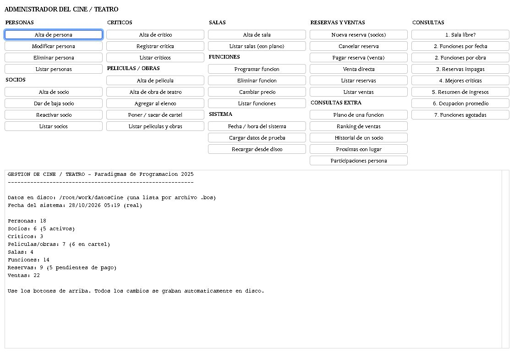
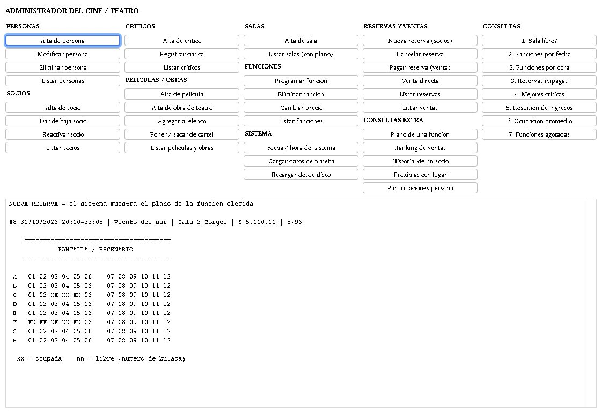
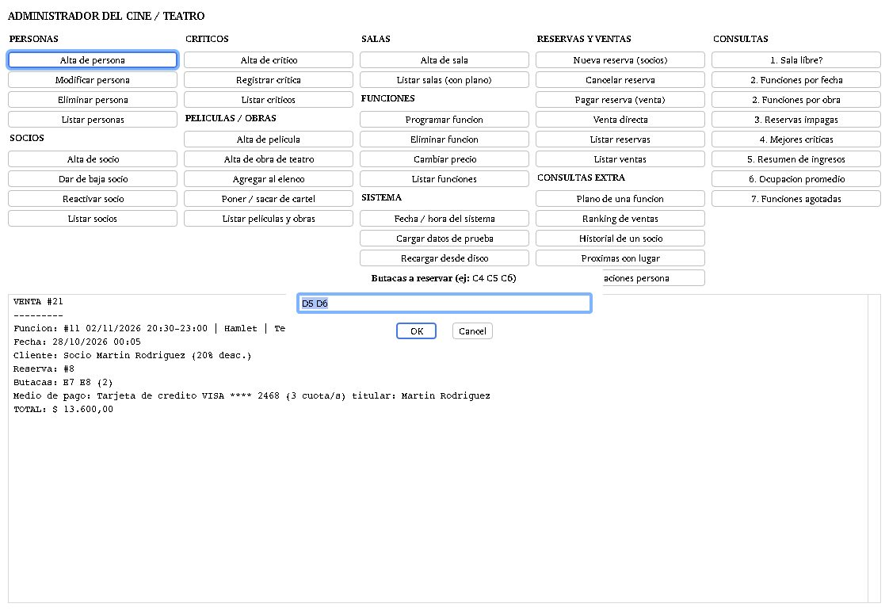
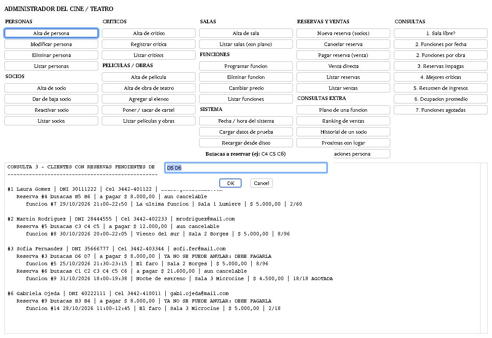
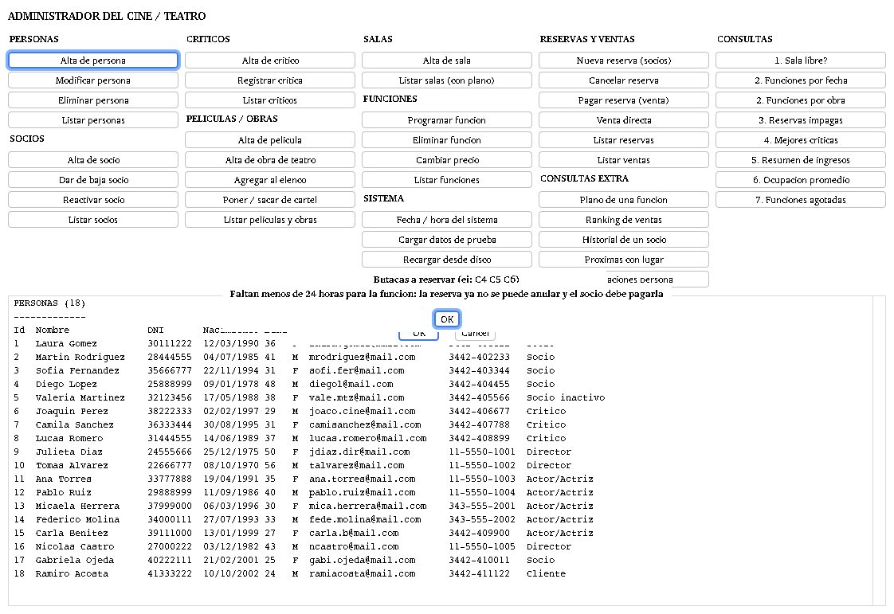
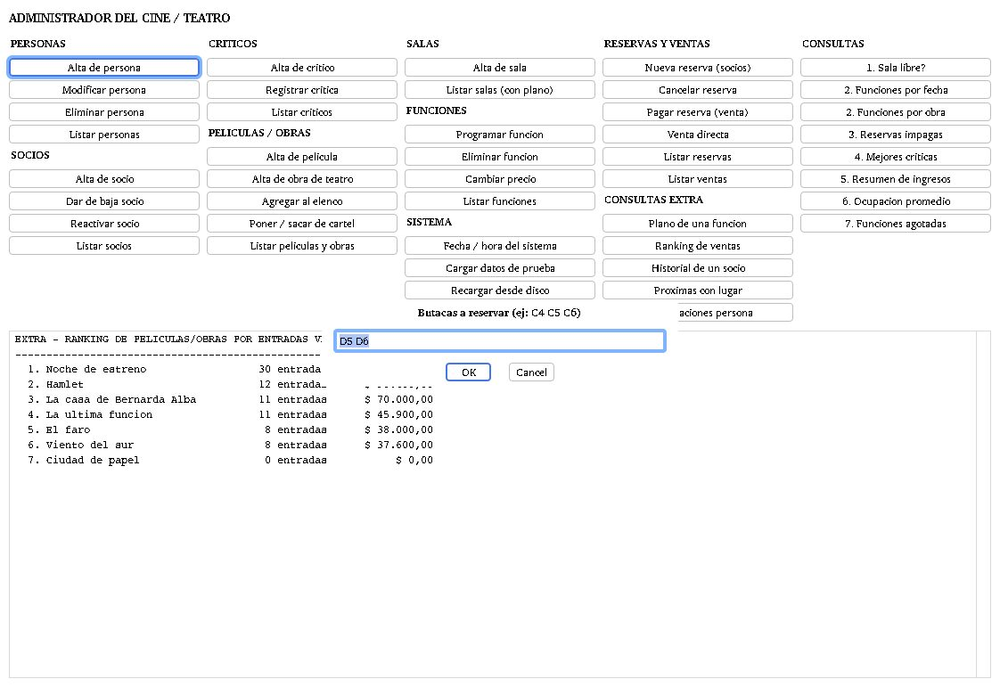

# Proyecto Paradigmas de Programación 2025 – Gestión de un Cine/Teatro

Implementado en **Smalltalk (VisualWorks 8.2)**. Es un solo paquete: `CineTeatro`.



## Contenido del repositorio

| Archivo | Qué es |
|---|---|
| `src/CineTeatro.st` | Código fuente completo (file-out XML de VisualWorks): 21 clases, unos 480 métodos |
| `datosCine/*.bos` | Datos de prueba ya cargados, una lista por archivo (personas, socios, criticos, obras, salas, funciones) |
| `docs/capturas/` | Capturas del sistema funcionando |

## Cómo cargarlo y abrirlo

1. Abrí VisualWorks 8.2 y, desde el Launcher, abrí un **Workspace**.
2. Cargá el código evaluando esta línea (seleccionala y elegí *Do it*). Ajustá la ruta si hace falta:
   ```smalltalk
   'C:\ruta\al\repo\src\CineTeatro.st' asFilename fileIn.
   ```
   También podés hacerlo desde el *File Browser*: seleccionás el archivo y elegís *File In*.
3. Abrí la interfaz:
   ```smalltalk
   VentanaCine open.
   ```
4. La pantalla de bienvenida muestra **la ruta exacta de la carpeta `datosCine`** que usa el sistema. Es relativa al directorio de trabajo de la imagen.
   - Si querés usar los datos de prueba incluidos, copiá la carpeta `datosCine` a esa ruta y presioná **Recargar desde disco**.
   - O simplemente presioná **Cargar datos de prueba**: genera todo de nuevo, con fechas relativas al día de hoy. Es lo recomendable antes de cada demostración.
5. Guardá la imagen (*File > Save Image*) para no tener que volver a hacer el *File In*.

Todos los cambios se graban solos en disco después de cada operación.

## Diseño

### Clases

| Clase | Responsabilidad |
|---|---|
| `AdministradorCine` | Clase central pedida por el enunciado. Gestión de personas, socios, críticos, obras, salas y funciones; reservas y ventas; consultas; persistencia; reloj del sistema |
| `Persona` | id, nombre, dni, fechaNacimiento, sexo, domicilio, email, celular |
| `Socio` | id, idPersona, fechaAlta, estado (#activo/#inactivo). Sabe aplicar su 20% de descuento |
| `Critico` / `Critica` | Usuario crítico; reseña con puntaje de 1 a 10 |
| `ObraArtistica` (abstracta) → `Pelicula`, `ObraTeatro` | Se dividió como sugiere el enunciado. **Polimorfismo**: `tipo`, `puedePresentarseEn: unaSala`, `admiteCriticas`, `agregarCritica:` |
| `Sala` / `Butaca` | La sala genera sus butacas (fila letra + número, con posición X/Y y pasillo central) y dibuja su plano |
| `Funcion` | Obra + sala + fecha + hora + precio, con `listaReservas` y `listaVentas`. Calcula ocupación y superposición de horarios, y pasa a **#agotada** sola |
| `Reserva` | Estados #pendiente / #confirmada / #cancelada; regla de las 24 hs |
| `Venta` | Directa (idReserva = nil) o desde una reserva; idSocio = nil si el comprador no es socio |
| `MedioPago` (abstracta) → `PagoEfectivo`, `PagoTarjeta`, `PagoTransferencia` | Datos específicos de cada medio (tarjeta: tipo, marca, últimos 4, cuotas, titular; transferencia: alias y número de operación) |
| `UtilCine` | Formatos y conversiones (fechas dd/mm/aaaa, horas hh:mm, moneda $ 1.234,50) |
| `ErrorCine` | Errores de negocio. La interfaz los muestra como aviso |
| `VentanaCine` | Interfaz gráfica (ApplicationModel): botones por módulo, diálogos para cargar datos y panel de resultados |

### Decisiones y adaptaciones respecto del enunciado
- **Persistencia**: cada lista se guarda en su propio archivo con **BOSS** (`BinaryObjectStorage`), en la carpeta `datosCine`. Las reservas y ventas se guardan dentro de cada función (`listaReservas` / `listaVentas`), como pide la clase Función, para no duplicar datos.
- Las relaciones se hacen por **id** (idPersona, idSala, idObra…), igual que en el enunciado.
- `Funcion` guarda su `capacidad` y su `duracion` al crearse, así puede saber sola si está agotada o si se superpone con otra.
- `Venta` tiene `idSocio` además de lo pedido: hace falta para el resumen de ingresos por tipo de cliente y para que un socio tenga su descuento también en compras directas.
- **Reloj simulado** (*Fecha / hora del sistema*): permite fijar una fecha y hora para demostrar la regla de las 24 hs, o vender en funciones "pasadas" al cargar datos.

### Reglas de negocio implementadas
- Solo los **socios activos** reservan. Las reservas se hacen sin pago y a nombre del socio.
- Una reserva se **cancela sin costo hasta 24 hs antes**. Después ya no se puede anular y figura como "DEBE PAGARLA".
- **20% de descuento** para socios en toda compra (con o sin reserva).
- Pagar una reserva genera la venta con las mismas butacas y deja la reserva **confirmada**.
- Una función no supera la capacidad de la sala. Con todas las butacas reservadas o vendidas pasa a **agotada**.
- Solo se programan funciones de obras **en cartel**, en salas que admiten ese tipo de obra, en el futuro y **sin superponerse** con otra función de la sala.
- Solo las **películas** reciben críticas (una por crítico; si repite, se reemplaza).
- Validaciones: DNI único y numérico, butacas existentes, libres y no repetidas, fechas y horas válidas, etc.

## Consultas (botones)

| Pedidas en el enunciado | Método en `AdministradorCine` |
|---|---|
| 1. ¿Sala libre entre fechas y horarios? | `salaLibre:desde:hora:hasta:hora:` |
| 2. Funciones por fecha / por película u obra | `funcionesDelDia:` / `funcionesDeObra:` |
| 3. Clientes con reservas pendientes de pago | `sociosConReservasPendientes` |
| 4. Películas en cartelera con mejores críticas | `peliculasEnCarteleraPorCriticas` |
| 5. Resumen de ingresos entre fechas (socio / no socio) | `resumenIngresosDesde:hasta:` (también discrimina por medio de pago) |
| 6. Ocupación promedio de cada película/obra | `ocupacionPromedioPorObra` |
| 7. Funciones agotadas | `funcionesAgotadas` |

**Consultas agregadas (se pedían al menos 3):**
1. **Plano de una función**: dibuja la sala con las posiciones X/Y de las butacas, marcando libres y ocupadas (`planoDeFuncion:`).
2. **Ranking de películas/obras** por entradas vendidas y recaudación (`rankingObrasPorVentas`).
3. **Historial de un socio**: sus reservas, compras y total gastado.
4. **Próximas funciones con lugar**: las que todavía no empezaron y no están agotadas.
5. **Participaciones de una persona**: obras que dirige o en las que actúa.

## Datos de prueba
*Cargar datos de prueba* genera, con fechas relativas al día de hoy:
- 18 personas.
- 6 socios (1 inactivo).
- 3 críticos y 10 críticas.
- 5 películas y 2 obras de teatro (1 película fuera de cartel).
- 4 salas: 1 solo cine, 1 mixta, 1 microcine de 18 butacas y 1 teatro.
- 14 funciones: 6 pasadas y 8 futuras.
- 22 ventas con los tres medios de pago, y 9 reservas en todos los estados.

Casos para mostrar:
- Funciones **agotadas**: una pasada y una futura (las dos en el Microcine).
- Una reserva vencida **sin pagar**.
- Una función que empieza en unas 6 horas, con una reserva que **ya no se puede cancelar**.
- Una reserva **cancelada** y otra **pagada**.

## Capturas

| | |
|---|---|
|  Plano de la sala al reservar |  Venta de socio con 20% de descuento |
|  Consulta 3: reservas pendientes de pago |  Aviso de la regla de las 24 horas |
|  Consulta extra: ranking de ventas | |

## Guion corto para la demostración
1. **Cargar datos de prueba** → **Listar funciones**.
2. **Nueva reserva**: elegir un socio y una función. Se muestra el plano; escribir las butacas (ej. `D5 D6`). Probar una butaca ocupada para ver el aviso.
3. **Cancelar reserva** sobre la de la función que empieza en pocas horas: el sistema no lo permite (regla de 24 hs).
4. **Pagar reserva** con tarjeta → se ve el 20% de descuento.
5. **Venta directa** a un no socio → **Plano de una función**.
6. Recorrer las consultas 1 a 7 y las extra.
7. Cerrar la ventana, volver a abrir con `VentanaCine open` (o **Recargar desde disco**) y mostrar que los datos persisten.

---
UTN FRCU · Paradigmas de Programación 2025 · Federico Haffner
