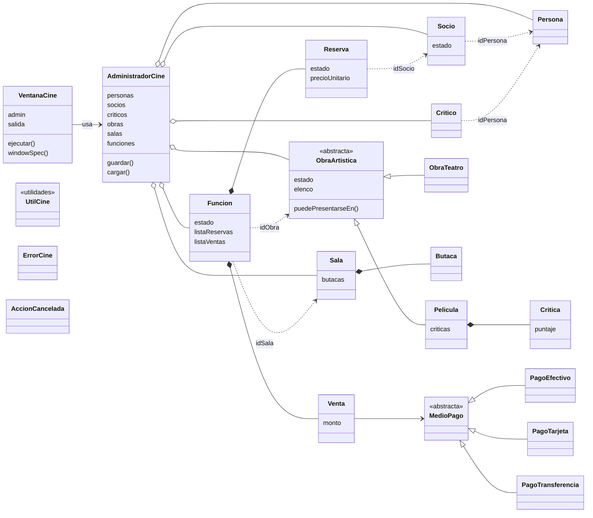

# Guía para entender el código

Esta guía está pensada para quien tiene que **explicar y defender** el trabajo sin haber escrito cada línea. Va de lo general a lo particular: primero la sintaxis de Smalltalk que aparece en el código, después qué clase hace qué, después los recorridos completos (qué pasa cuando apretás un botón) y al final las preguntas que suelen hacer en la defensa.

Todos los fragmentos de código son **copias del código real** de `src/CineTeatro.st`. Para verlos en VisualWorks: abrí el *System Browser*, buscá el paquete `CineTeatro`, elegí la clase y el método.

**Índice**

1. [Repaso de Smalltalk](#1-repaso-de-smalltalk)
2. [Mapa de clases](#2-mapa-de-clases)
3. [Clase por clase](#3-clase-por-clase)
4. [Recorridos paso a paso](#4-recorridos-paso-a-paso)
5. [Persistencia con BOSS](#5-persistencia-con-boss)
6. [La interfaz](#6-la-interfaz)
7. [Las pruebas automáticas](#7-las-pruebas-automáticas)
8. [Cómo agregar cosas](#8-cómo-agregar-cosas)
9. [Preguntas típicas de la defensa](#9-preguntas-típicas-de-la-defensa)
10. [Trampas de VisualWorks](#10-trampas-de-visualworks)

---

## 1. Repaso de Smalltalk

En Smalltalk **todo es un objeto** y lo único que se hace es **mandarle mensajes** a los objetos. No hay `if`, `for` ni `while` como palabras del lenguaje: son mensajes.

### Los tres tipos de mensaje

| Tipo | Forma | Ejemplo del código | Se lee |
|---|---|---|---|
| Unario | `objeto mensaje` | `socio estaActivo` | "socio, ¿estás activo?" |
| Binario | `objeto + otro` | `bruto := unPrecio * unaCantidad` | operadores: `+ - * / , = < >` |
| De palabra clave | `objeto clave: argumento` | `admin cancelarReserva: r id` | uno o más argumentos, cada uno después de `:` |

Un mensaje de palabra clave con varios argumentos es **un solo mensaje**. Este se llama `reservarSocio:funcion:butacas:`:

```smalltalk
admin reservarSocio: s id funcion: f id butacas: codigos
```

**Orden en que se resuelven:** primero los unarios, después los binarios, al final los de palabra clave; a igual tipo, de izquierda a derecha. Los paréntesis cambian el orden. Ojo: no hay precedencia matemática, `2 + 3 * 4` da 20.

```smalltalk
^unMonto * (100 - self class porcentajeDescuento) / 100
```

Se resuelve: `self class` → `porcentajeDescuento` (unarios), después el paréntesis, después `*` y `/` de izquierda a derecha.

### Lo básico

| Símbolo | Significado |
|---|---|
| `:=` | asignación |
| `^` | devolver un valor (return). Si un método no tiene `^`, devuelve `self` |
| `\| a b \|` | declaración de variables temporales |
| `"texto"` | comentario |
| `'texto'` | String (cadena). Se concatenan con la coma: `'Hola ' , nombre` |
| `#activo` | Symbol: un nombre único, se compara rápido. Se usa para los estados |
| `$a` | un carácter |
| `#(1 2 3)` | Array literal |
| `.` | separa sentencias |
| `self` | el objeto que recibió el mensaje |
| `super` | igual que `self`, pero busca el método a partir de la superclase |
| `nil` | "nada". Se pregunta con `isNil` / `notNil` |

### Cascada (`;`)

El punto y coma manda **varios mensajes al mismo objeto**. Se usa todo el tiempo para armar objetos:

```smalltalk
socio := Socio new
	id: (self siguienteIdEn: socios);
	idPersona: unIdPersona;
	fechaAlta: self hoy;
	activar;
	yourself.
```

Todos esos mensajes van a `Socio new`. El `yourself` del final hace que la expresión devuelva el socio y no el resultado del último mensaje.

### Bloques

Un bloque es **código entre corchetes que se guarda para ejecutar después**. Es un objeto: se puede guardar en una variable o pasar como argumento. Los parámetros se declaran con `:`.

```smalltalk
[:f | f estaAgotada]        "bloque con un parametro"
[self guardar]              "bloque sin parametros"
```

### Decisiones

`ifTrue:` e `ifFalse:` son mensajes que se le mandan a un booleano, con un bloque como argumento:

```smalltalk
socio estaActivo ifFalse: [^self fallar: 'Solo los socios activos pueden reservar'].

estado := self cantidadOcupadas >= capacidad ifTrue: [#agotada] ifFalse: [#disponible]
```

`and:` y `or:` reciben un bloque para no evaluar la segunda parte si no hace falta:

```smalltalk
^inicioSeg < self finEnSegundos and: [self inicioEnSegundos < finSeg]
```

Un `^` **dentro de un bloque** termina el método entero, no solo el bloque. Por eso `ifFalse: [^self fallar: '...']` corta el método ahí.

### Recorrer colecciones

Casi no hay ciclos "a mano": se le pide a la colección que haga el trabajo.

| Mensaje | Qué devuelve | Ejemplo real |
|---|---|---|
| `do:` | nada; ejecuta el bloque con cada elemento | `admin personas do: [:p \| ...]` |
| `select:` | los que cumplen | `funciones select: [:f \| f estaAgotada]` |
| `reject:` | los que **no** cumplen | `listaReservas reject: [:r \| r estaCancelada]` |
| `collect:` | una colección con el resultado de cada uno | `butacas collect: [:b \| b codigo]` |
| `detect:ifNone:` | el primero que cumple (o lo que diga el segundo bloque) | `personas detect: [:p \| p id = unId] ifNone: [nil]` |
| `anySatisfy:` | `true` si alguno cumple | `criticos anySatisfy: [:c \| c idPersona = unId]` |
| `inject:into:` | un acumulado (suma, máximo...) | ver abajo |
| `isEmpty` / `notEmpty` / `size` / `includes:` | consultas simples | |

`inject:into:` arranca con un valor y lo va combinando con cada elemento. Así se calcula el próximo id (el mayor id que haya, más 1):

```smalltalk
siguienteIdEn: unaColeccion
	^(unaColeccion inject: 0 into: [:max :e | max max: e id]) + 1
```

Y un ciclo con contador, cuando hace falta:

```smalltalk
1 to: cantFilas do: [:f | ...]
```

### Colecciones que usa el sistema

| Clase | Para qué se usa |
|---|---|
| `OrderedCollection` | Todas las listas (personas, socios, funciones, reservas...). Crece sola, mantiene el orden |
| `Array` | Tamaño fijo. Opciones de los diálogos, filas de resultado de una consulta |
| `Set` | Sin repetidos: `codigosOcupados` de una función |
| `Dictionary` | Clave → valor: el resumen de ingresos (`#total`, `#totalSocios`...) |
| `SortedCollection` | Ordenada por un bloque: `asSortedCollection: [:a :b \| a id <= b id]` |

### Clases, instancias y `new`

- Las **variables de instancia** (los atributos) solo se pueden tocar desde los métodos del propio objeto. Desde afuera se usan los métodos de acceso: `nombre` devuelve y `nombre:` modifica. Eso es el **encapsulamiento**.
- Los **métodos de clase** se le mandan a la clase, no a una instancia: `Socio new`, `Socio porcentajeDescuento`, `UtilCine textoFecha: unaFecha`.
- En VisualWorks, `new` **no llama a `initialize`** por sí solo. Por eso cada clase raíz del sistema redefine `new` del lado de la clase:

```smalltalk
new
	"Answer a newly created and initialized instance."
	^super new initialize
```

Las subclases (`Pelicula`, `PagoTarjeta`...) heredan ese `new` y solo redefinen `initialize`, empezando con `super initialize`.

### Mostrar un objeto: `printOn:`

Cuando se pide `unObjeto printString`, Smalltalk llama a `printOn:`. Cada clase lo redefine para mostrarse de forma útil:

```smalltalk
printOn: aStream
	aStream nextPutAll: '#' , id printString , ' ' , nombre , ' (DNI ' , dni , ')'
```

### Errores (excepciones)

```smalltalk
[unBloque value]
	on: ErrorCine
	do: [:e | ... e messageText ... e return: nil]
```

Se lee: "ejecutá este bloque; si adentro se produce un `ErrorCine`, ejecutá este otro". `ensure:` es el "pase lo que pase":

```smalltalk
[bos nextPut: unaColeccion] ensure: [bos close]
```

El archivo se cierra aunque la escritura falle.

---

## 2. Mapa de clases



Cómo leerlo:

- **Flecha con triángulo** (`<|--`): herencia. `Pelicula` *es una* `ObraArtistica`.
- **Rombo** (`o--` / `*--`): "tiene una lista de". El administrador tiene las seis listas principales; cada función tiene adentro sus reservas y sus ventas.
- **Línea punteada**: relación **por id**. Un `Socio` no guarda a la persona, guarda su `idPersona`; para llegar a la persona se le pide al administrador (`admin personaId: socio idPersona`).

Son tres capas:

| Capa | Clases | Qué sabe |
|---|---|---|
| Interfaz | `VentanaCine` | Botones, diálogos, armar los textos que se muestran. **No tiene reglas de negocio** |
| Coordinación | `AdministradorCine` | Las listas, las validaciones, las operaciones, las consultas, guardar y leer |
| Dominio | `Persona`, `Socio`, `Funcion`, `Reserva`... | Sus datos y lo que cada una sabe calcular sobre sí misma |

---

## 3. Clase por clase

### AdministradorCine

Es la clase central que pide el enunciado. Atributos: las seis listas (`personas socios criticos obras salas funciones`), `carpetaDatos`, el reloj simulado (`fechaSimulada horaSimulada`) y `listasIlegibles`.

**Una sola instancia para todo el programa** (patrón *Singleton*). La clase la guarda en una variable de instancia de clase (`instancia`) y la crea la primera vez que se la piden:

```smalltalk
default
	"Instancia unica usada por la interfaz. Lee los datos de disco la primera vez."
	instancia isNil ifTrue: [instancia := self enCarpeta: self carpetaPorDefecto].
	^instancia
```

Las pruebas no usan `default`: crean su propio administrador con `AdministradorCine enCarpeta: 'pruebasCineTmp'`, así nunca tocan los datos reales.

**Todas las operaciones siguen el mismo molde**: buscar los objetos, validar, hacer el cambio, guardar, devolver el resultado.

```smalltalk
bajaSala: unId
	"Solo se elimina una sala que no tenga funciones (ni pasadas ni futuras)"
	| sala cantidad |
	sala := self salaId: unId.
	cantidad := (self funcionesDeSala: unId) size.
	cantidad > 0 ifTrue: [^self fallar: 'No se puede eliminar: la sala ' , sala nombre , ' tiene ' , cantidad printString , ' funcion/es'].
	salas remove: sala.
	self guardar.
	^sala
```

Tres piezas que se repiten en todos lados:

```smalltalk
fallar: unMensaje
	^ErrorCine new raiseSignal: unMensaje

buscar: unId en: unaColeccion nombre: unNombre
	^unaColeccion detect: [:e | e id = unId] ifNone: [self fallar: 'No existe ' , unNombre , ' con id ' , unId printString]

siguienteIdEn: unaColeccion
	^(unaColeccion inject: 0 into: [:max :e | max max: e id]) + 1
```

- `fallar:` corta la operación con un error de negocio. Como está **antes** de modificar y de `self guardar`, si algo falla no se cambia nada.
- `personaId:`, `socioId:`, `salaId:`, `funcionId:`... son todos una línea que llama a `buscar:en:nombre:`.

**El reloj.** Nadie en el sistema usa `Date today` directamente: todos preguntan `self hoy` y `self horaActual`. Así se puede "mentir" la fecha para demostrar la regla de las 24 horas y para que las pruebas den siempre lo mismo.

```smalltalk
hoy
	^fechaSimulada isNil ifTrue: [Date today] ifFalse: [fechaSimulada]
```

Cómo están agrupados los métodos (categorías en el browser):

| Categoría | Métodos principales |
|---|---|
| personas | `altaPersonaNombre:dni:...`, `modificarPersona:nombre:dni:...`, `bajaPersona:`, `validarDni:exceptoId:` |
| socios | `altaSocioPersona:`, `darDeBajaSocio:`, `reactivarSocio:`, `sociosActivos` |
| críticos | `altaCriticoPersona:usuario:`, `bajaCritico:`, `registrarCriticaDe:obra:resena:puntaje:`, `bajaCriticaDe:obra:` |
| obras | `altaPeliculaTitulo:...`, `altaObraTeatroTitulo:...`, `modificarObra:...`, `bajaObra:`, `agregarAlElenco:obra:`, `quitarDelElenco:obra:`, `ponerEnCartel:`, `sacarDeCartel:` |
| salas | `altaSalaNombre:filas:butacasPorFila:...`, `modificarSala:...`, `bajaSala:` |
| funciones | `programarFuncionObra:sala:fecha:hora:precio:`, `modificarPrecio:funcion:`, `cancelarFuncion:` |
| reservas / ventas | `reservarSocio:funcion:butacas:`, `cancelarReserva:`, `venderReserva:medioPago:`, `venderFuncion:butacas:medioPago:socio:` |
| consultas | las 7 del enunciado y las 5 agregadas (ver README) |
| persistencia | `guardar`, `cargar`, `guardarLista:en:`, `leerListaDe:` |
| reloj | `hoy`, `horaActual`, `ahoraEnSegundos`, `simularFecha:hora:`, `usarRelojReal` |

### Persona

Atributos: `id nombre dni fechaNacimiento sexo domicilio email celular`. Es una clase de datos: métodos de acceso, `edadAl: unaFecha`, `descripcionCompleta` y `printOn:`. Las validaciones (DNI numérico y sin repetir, fecha de nacimiento no futura) las hace el administrador, porque para saber si un DNI está repetido hay que mirar toda la lista.

### Socio

Atributos: `id idPersona fechaAlta estado`. El estado es un símbolo: `#activo` o `#inactivo`. Un socio nunca se borra: se da de baja (queda inactivo) para conservar su historial.

El porcentaje de descuento está en un solo lugar, un método de clase, y el socio sabe aplicarlo:

```smalltalk
aplicarDescuentoA: unMonto
	^unMonto * (100 - self class porcentajeDescuento) / 100
```

### Critico y Critica

`Critico`: `id idPersona nombreUsuario fechaAlta`. `Critica`: `idCritico resena puntaje fecha`. Las críticas viven **dentro de la película** (en su lista `criticas`), no en una lista aparte.

### ObraArtistica → Pelicula, ObraTeatro

`ObraArtistica` es **abstracta**: nunca se crea una, solo películas u obras de teatro. Tiene lo común: `id titulo descripcion duracion clasificacion elenco director estado`. `Pelicula` agrega `criticas`.

Acá está el **polimorfismo** más claro del trabajo. La superclase declara qué hay que saber responder y cada subclase contesta a su manera:

```smalltalk
"ObraArtistica"
puedePresentarseEn: unaSala
	"Indica si la sala admite este tipo de obra"
	^self subclassResponsibility

"Pelicula"
puedePresentarseEn: unaSala
	^unaSala permitePeliculas

"ObraTeatro"
puedePresentarseEn: unaSala
	^unaSala permiteTeatro
```

Gracias a eso, al programar una función el administrador **no pregunta de qué tipo es la obra**:

```smalltalk
(obra puedePresentarseEn: sala) ifFalse: [^self fallar: 'La sala ' , sala nombre , ' no admite ' , obra tipoTexto].
```

Lo mismo con las críticas. Para una obra cualquiera, `agregarCritica:` da error; `Pelicula` lo redefine:

```smalltalk
"ObraArtistica"
agregarCritica: unaCritica
	^ErrorCine new raiseSignal: 'Solo se pueden registrar criticas de peliculas, no de obras de teatro'

"Pelicula"
agregarCritica: unaCritica
	"Un critico deja una sola critica por pelicula: si ya existia, se reemplaza"
	| anterior |
	anterior := criticas detect: [:c | c idCritico = unaCritica idCritico] ifNone: [nil].
	anterior isNil ifFalse: [criticas remove: anterior].
	criticas add: unaCritica
```

Otros métodos polimórficos: `tipo`, `tipoTexto`, `admiteCriticas`, `esPelicula`, `criticas`, `quitarCriticaDe:`.

### Sala y Butaca

`Sala`: `id nombre permitePeliculas permiteTeatro butacas`. La sala **crea sus propias butacas** cuando se la da de alta:

```smalltalk
generarButacasFilas: cantFilas porFila: cantPorFila
	"Genera las butacas A1..; deja un pasillo central (posicionX salta una columna en la mitad)"
	| letra x |
	butacas := OrderedCollection new.
	1 to: cantFilas do: [:f |
		letra := String with: (Character value: 64 + f).
		1 to: cantPorFila do: [:n |
			x := n > (cantPorFila // 2) ifTrue: [n + 1] ifFalse: [n].
			butacas add: (Butaca fila: letra numero: n x: x y: f)]]
```

`Character value: 64 + f` da la letra: 65 es la A, 66 la B... La `posicionX` salta un lugar en la mitad de la fila: ese hueco es el pasillo que se ve en el plano. `planoMarcando: codigosOcupados` dibuja la sala usando esas posiciones.

`Butaca`: `fila numero posicionX posicionY`. Su `codigo` es la fila más el número (`'C7'`). Redefine `=` y `hash` para que dos butacas con la misma fila y número se consideren iguales aunque sean objetos distintos (pasa al releer de disco: las butacas guardadas dentro de una reserva son copias de las de la sala).

### Funcion

Atributos: `id idObra idSala fecha horaInicio duracion precioEntrada capacidad estado listaReservas listaVentas`. Es la clase de dominio con más lógica propia. Al crearse copia la `duracion` de la obra y la `capacidad` de la sala, y con eso puede contestar sola:

```smalltalk
seSuperponeDesde: inicioSeg hasta: finSeg
	^inicioSeg < self finEnSegundos and: [self inicioEnSegundos < finSeg]

codigosOcupados
	| ocupados |
	ocupados := Set new.
	self reservasActivas do: [:r | r listaButacasReservadas do: [:b | ocupados add: b codigo]].
	listaVentas do: [:v | v butacasVendidas do: [:b | ocupados add: b codigo]].
	^ocupados

actualizarEstado
	"Si todas las butacas estan reservadas o vendidas, la funcion pasa a estar agotada"
	estado := self cantidadOcupadas >= capacidad ifTrue: [#agotada] ifFalse: [#disponible]
```

- Las butacas ocupadas son un `Set` (no hay repetidos): una reserva pagada aparece como reserva confirmada **y** como venta, y se cuenta una sola vez.
- `agregarReserva:` y `agregarVenta:` llaman a `actualizarEstado`: la función pasa a `#agotada` sola. Si se cancela una reserva, vuelve a `#disponible`.

### Reserva

Atributos: `id idSocio idFuncion listaButacasReservadas fechaReserva fechaCancelacion estado precioUnitario`. Estados: `#pendiente` → `#confirmada` (se pagó) o `#cancelada`.

```smalltalk
puedeCancelarseFaltando: segundosHastaFuncion
	"Sin costo solo si falta al menos el limite de horas para la funcion"
	^self estaPendiente and: [segundosHastaFuncion >= (self class horasLimiteCancelacion * 3600)]
```

`precioUnitario` guarda el precio de la entrada **en el momento de reservar**. Si después cambia el precio de la función, la reserva se cobra al precio viejo.

### Venta

Atributos: `id idReserva idFuncion idSocio fecha hora monto medioPago butacasVendidas`. Dos preguntas simples que evitan comparar con `nil` por todos lados: `esDirecta` (`idReserva` es `nil`) y `esDeSocio` (`idSocio` no es `nil`).

### MedioPago → PagoEfectivo, PagoTarjeta, PagoTransferencia

Otra jerarquía con polimorfismo. Todos responden `tipo`, `nombre` y `descripcion`; cada uno guarda sus datos (`PagoTarjeta`: tipo, marca, titular, últimos 4 dígitos, cuotas; `PagoTransferencia`: alias y número de operación). La venta guarda **un** medio de pago y no le importa cuál es: al mostrarla solo pide `unaVenta medioPago descripcion`.

### UtilCine

Solo métodos de clase: conversiones y formatos que se usan en todos lados. `fechaDesde:` (`'15/06/2030'` → `Date`), `horaDesde:`, `enteroDesde:`, `numeroDesde:` (importes a la argentina: `'4.500,50'`), `textoFecha:`, `textoHora:`, `textoMoneda:` (`$ 4.500,50`), `segundosDe:hora:`, `palabras:`. Si el texto no sirve, lanzan un `ErrorCine` con un mensaje claro.

### ErrorCine y AccionCancelada

Dos excepciones propias (subclases de `Error`):

- `ErrorCine`: **error de negocio** ("la butaca ya está ocupada"). La ventana lo muestra como aviso.
- `AccionCancelada`: el usuario apretó Cancelar en un diálogo. No es un error: la ventana simplemente no hace nada.

### VentanaCine

Subclase de `ApplicationModel` (la clase de VisualWorks para ventanas). Tiene dos atributos: `admin` (el administrador) y `salida` (el texto que se ve en el panel). Se explica entera en la [sección 6](#6-la-interfaz).

---

## 4. Recorridos paso a paso

### Abrir el programa

Se evalúa `VentanaCine open` en un Workspace.

1. `open` (heredado de `ApplicationModel`) crea la ventana con `new`, que llama a `initialize`:
   ```smalltalk
   initialize
   	"Si nadie le paso un administrador (ver conAdministrador:), usa el unico del sistema"
   	super initialize.
   	admin isNil ifTrue: [admin := AdministradorCine default].
   	salida := String new asValue
   ```
2. `AdministradorCine default` crea el administrador (si no existía) con `enCarpeta: 'datosCine'`, que llama a `cargar`: lee cada archivo `.bos` de la carpeta y llena las listas.
3. VisualWorks arma la ventana leyendo `windowSpec` (dónde va cada botón y qué método llama).
4. Cuando la ventana ya está en pantalla, VisualWorks llama a `postOpenWith:`, que muestra la bienvenida (cuántas personas, socios, funciones hay, y la carpeta de datos).

### Reservar (botón "Nueva reserva")

El botón llama a `VentanaCine>>nuevaReserva`:

```smalltalk
nuevaReserva
	self ejecutar: [| s f r |
		s := self elegirSocio: 'Socio que reserva' entre: admin sociosActivos.
		f := self elegirFuncion: 'Funcion' entre: admin proximasFuncionesConDisponibilidad.
		self mostrar: (admin descripcionFuncion: f) , (String with: Character cr with: Character cr) , (admin planoDeFuncion: f id).
		r := admin reservarSocio: s id funcion: f id butacas: (self pedirButacas: 'Butacas a reservar').
		self mostrar: 'Reserva #' , r id printString , ' registrada a nombre de ' , ...]
```

1. Se elige el socio de una lista que **solo trae socios activos**, y la función de una lista que solo trae funciones futuras con lugar. La interfaz ya evita la mayoría de los errores ofreciendo solo lo que se puede elegir.
2. Se muestra el plano de la sala para ver qué butacas están libres.
3. Se piden las butacas (`'C4 C5'`) y se llama al administrador:

```smalltalk
reservarSocio: unIdSocio funcion: unIdFuncion butacas: unosCodigos
	| socio funcion butacas reserva |
	socio := self socioId: unIdSocio.
	socio estaActivo ifFalse: [^self fallar: 'Solo los socios activos pueden reservar'].
	funcion := self funcionId: unIdFuncion.
	(funcion comenzoA: self ahoraEnSegundos) ifTrue: [^self fallar: 'La funcion ya comenzo o finalizo'].
	funcion estaAgotada ifTrue: [^self fallar: 'La funcion esta agotada'].
	butacas := self butacas: unosCodigos paraFuncion: funcion.
	reserva := Reserva new
		id: (self siguienteIdEn: self todasLasReservas);
		idSocio: unIdSocio;
		idFuncion: unIdFuncion;
		listaButacasReservadas: butacas;
		fechaReserva: self hoy;
		precioUnitario: funcion precioEntrada;
		yourself.
	funcion agregarReserva: reserva.
	self guardar.
	^reserva
```

4. El administrador **vuelve a validar todo** (no confía en la interfaz): socio activo, función que no empezó, no agotada. `butacas:paraFuncion:` revisa que haya al menos una butaca, que no estén repetidas, que existan en la sala y que estén libres.
5. Crea la `Reserva` (nace `#pendiente`, con el precio de hoy) y se la da a la función. `agregarReserva:` actualiza el estado: si era la última butaca libre, la función queda `#agotada`.
6. `self guardar` graba en disco. La ventana muestra la reserva, lo que hay que pagar (con el 20% de descuento) y el plano actualizado.

Si algo falla, `fallar:` lanza un `ErrorCine`, que sube hasta `ejecutar:` y se muestra como aviso. No se guarda nada.

### Pagar una reserva (botón "Pagar reserva")

```smalltalk
pagarReserva
	self ejecutar: [| r v |
		r := self elegirReserva: 'Reserva a pagar' entre: admin reservasPendientes.
		v := admin venderReserva: r id medioPago: self pedirMedioPago.
		self mostrar: (self textoVenta: v)]
```

1. Se elige una reserva pendiente y el medio de pago. `pedirMedioPago` pregunta el tipo y, según cuál sea, los datos que correspondan; devuelve un `PagoEfectivo`, un `PagoTarjeta` o un `PagoTransferencia` ya armado.
2. `venderReserva:medioPago:` crea la `Venta` con **las mismas butacas** de la reserva, calcula el monto, marca la reserva como `#confirmada` (`reserva confirmar`), agrega la venta a la función y guarda.
3. El monto sale de acá:

```smalltalk
montoDeReserva: unaReserva
	^self calcularMontoPrecio: unaReserva precioUnitario cantidad: unaReserva cantidadButacas socio: (self socioId: unaReserva idSocio)

calcularMontoPrecio: unPrecio cantidad: unaCantidad socio: unSocioOrNil
	"Importe a cobrar, redondeado al centavo"
	| bruto monto |
	bruto := unPrecio * unaCantidad.
	monto := unSocioOrNil isNil ifTrue: [bruto] ifFalse: [unSocioOrNil aplicarDescuentoA: bruto].
	^(monto * 100) rounded / 100
```

Se usa `unaReserva precioUnitario` (el precio de cuando reservó), no el precio actual de la función.

### Cancelar una reserva (botón "Cancelar reserva")

```smalltalk
cancelarReserva: unIdReserva
	"Se puede cancelar sin costo hasta 24 hs antes; despues ya no se anula y el socio debe pagarla"
	| reserva funcion |
	reserva := self reservaId: unIdReserva.
	reserva estaPendiente ifFalse: [^self fallar: 'Solo se pueden cancelar reservas pendientes (la reserva esta ' , reserva estado , ')'].
	funcion := self funcionId: reserva idFuncion.
	(reserva puedeCancelarseFaltando: (funcion segundosHastaInicioDesde: self ahoraEnSegundos))
		ifFalse: [^self fallar: 'Faltan menos de ' , Reserva horasLimiteCancelacion printString , ' horas para la funcion: la reserva ya no se puede anular y el socio debe pagarla'].
	reserva cancelarEl: self hoy.
	funcion actualizarEstado.
	self guardar.
	^reserva
```

Cada objeto contesta lo que sabe: la **función** dice cuántos segundos faltan para que empiece, la **reserva** decide si con ese tiempo se puede cancelar, y el **administrador** coordina. La reserva no se borra: queda `#cancelada` con su fecha (por eso figura en el historial del socio). `funcion actualizarEstado` libera las butacas: si la función estaba agotada, vuelve a estar disponible.

### Venta directa (botón "Venta directa")

Igual que la reserva pero sin reserva: se elige función, se escriben las butacas, se pregunta si el comprador es socio (si lo es, se elige cuál: solo activos) y el medio de pago. `venderFuncion:butacas:medioPago:socio:` valida lo mismo que una reserva y crea la `Venta` con `idReserva: nil`. Si se pasó un socio, se le aplica el descuento; si no, `idSocio` queda en `nil`.

La ventana valida las butacas **antes** de preguntar por el pago (`admin butacas: codigos paraFuncion: f`), para no hacer cargar los datos de la tarjeta si la butaca ya estaba ocupada.

### Programar una función: cómo se evita la superposición

```smalltalk
inicio := UtilCine segundosDe: unaFecha hora: unaHora.
inicio > self ahoraEnSegundos ifFalse: [^self fallar: 'No se puede programar una funcion en el pasado'].
fin := inicio + (obra duracion * 60).
conflictos := self funcionesEnSala: unIdSala desde: inicio hasta: fin.
conflictos isEmpty ifFalse: [^self fallar: 'La sala no esta libre en ese horario. Se superpone con: ' , (self descripcionFuncion: conflictos first)].
```

La fecha y la hora se convierten en **un solo número: segundos** (`unaFecha asSeconds + unaHora asSeconds`). Con eso, comparar horarios es comparar números, y una función que empieza a las 23:00 y termina a la 1:00 del día siguiente no necesita ningún caso especial. Dos intervalos se pisan cuando *cada uno empieza antes de que termine el otro* (`seSuperponeDesde:hasta:`). Una función que termina a las 22:00 y otra que empieza a las 22:00 no se superponen.

---

## 5. Persistencia con BOSS

**BOSS** (*Binary Object Storage System*) viene con VisualWorks: guarda un objeto en un archivo **junto con todo lo que ese objeto referencia**, y después lo reconstruye. No hay que convertir nada a texto.

El sistema guarda **una lista por archivo**, en la carpeta `datosCine`:

```smalltalk
nombresDeListas
	^#(#personas #socios #criticos #obras #salas #funciones)

archivoDe: unNombre
	^carpetaDatos asFilename construct: unNombre , '.bos'
```

Las reservas y las ventas no tienen archivo propio: están dentro de cada función, así que viajan en `funciones.bos`. Las butacas viajan dentro de cada sala y las críticas dentro de cada película.

**Guardar** (se llama al final de cada operación que cambia algo):

```smalltalk
guardar
	self listasIlegibles isEmpty ifFalse: [...].
	carpetaDatos asFilename ensureDirectory.
	self nombresDeListas do: [:nombre | self guardarLista: (self perform: nombre) en: (self archivoDe: nombre)]

guardarLista: unaColeccion en: unArchivo
	| bos |
	bos := BinaryObjectStorage onNew: unArchivo writeStream.
	[bos nextPut: unaColeccion] ensure: [bos close]
```

`self perform: nombre` manda el mensaje cuyo nombre está en la variable: con `#personas` equivale a `self personas`. Así un solo ciclo sirve para las seis listas.

**Leer:**

```smalltalk
leerListaDe: unArchivo
	| stream bos lista |
	stream := unArchivo readStream.
	[bos := BinaryObjectStorage onOldNoScan: stream.
	lista := bos next]
		ensure: [bos isNil ifTrue: [stream close] ifFalse: [bos close]].
	(lista isKindOf: OrderedCollection) ifFalse: [^self error: 'el archivo no contiene una lista'].
	^lista
```

**Por qué las relaciones son por id.** Si un `Socio` guardara a su `Persona` como objeto, al grabar `socios.bos` BOSS guardaría también una copia de cada persona, distinta de la que está en `personas.bos`. Al releer habría dos "Ana": cambiarle el nombre a una no cambiaría la otra. Guardando solo el `idPersona`, cada dato está en un único archivo.

**Si un archivo está dañado.** `cargar` anota su nombre en `listasIlegibles` y sigue con los demás. Mientras haya alguno, `guardar` se niega a grabar (y avisa): si grabara, pisaría el archivo dañado con una lista vacía y esos datos se perderían para siempre. Se soluciona reparando o quitando el archivo y usando *Recargar desde disco*, o con *Cargar datos de prueba* para empezar de cero.

**Si se cambian los atributos de una clase**, los `.bos` viejos pueden dejar de leerse (se guardaron con la forma anterior de la clase). Pasó al agregarle `precioUnitario` a `Reserva`: `funciones.bos` quedó ilegible. La solución es regenerar los datos con *Cargar datos de prueba*.

---

## 6. La interfaz

### Cómo está armada la ventana: `windowSpec`

`VentanaCine class>>windowSpec` es un método de clase que devuelve un **Array literal con la descripción de la ventana**: tamaño, título y cada componente. VisualWorks lo lee y construye la ventana. Un botón se ve así:

```smalltalk
#(#{UI.ActionButtonSpec} #layout: #(#{Graphics.Rectangle} 8 58 161 80) #name: #altaPersona #model: #altaPersona #label: 'Alta de persona' #defaultable: true)
```

- `#layout:` es el rectángulo que ocupa (izquierda, arriba, derecha, abajo).
- `#label:` es el texto del botón.
- **`#model: #altaPersona` es lo importante: es el nombre del método de `VentanaCine` que se ejecuta al apretar el botón.**

Y el panel de texto de abajo:

```smalltalk
#(#{UI.TextEditorSpec} #layout: #(#{Graphics.LayoutFrame} 8 0 304 0 -8 1 -8 1) #name: #salida #flags: 15 #model: #salida #isReadOnly: true #isWrapped: false ... #style: #fixed)
```

- `#model: #salida`: el panel muestra lo que devuelve el método `salida` de la ventana.
- `LayoutFrame ... -8 1 -8 1`: el panel se estira hasta 8 píxeles del borde derecho y del borde inferior, así crece si se agranda la ventana.
- `#isReadOnly: true`: no se puede escribir. `#isWrapped: false` con `#flags: 15`: las líneas largas no se cortan, aparece una barra horizontal. `#style: #fixed`: letra de ancho fijo, para que las columnas de los listados queden alineadas.

La ventana mide 1122 × 660 y tiene 51 botones en 7 columnas, agrupados por módulo.

### `salida` es un ValueHolder

```smalltalk
salida := String new asValue      "en initialize"

mostrar: unTexto
	salida value: unTexto
```

`asValue` envuelve el texto en un **ValueHolder**: una cajita que guarda un valor y **avisa a quien esté mirando cada vez que el valor cambia**. El panel de texto está "suscripto" a esa cajita. Por eso alcanza con hacer `salida value: unTexto` para que la pantalla se actualice sola: en ningún lado del código se le dice al panel "redibujate". (Es el patrón *Observer*, que en Smalltalk se llama mecanismo de dependencias.)

### Todos los botones pasan por `ejecutar:`

```smalltalk
ejecutar: unBloque
	"Ejecuta una accion de la interfaz mostrando los errores de negocio como aviso"
	^[[unBloque value]
		on: ErrorCine
		do: [:e |
			self mostrar: 'ATENCION: ' , e messageText.
			self dialogoAvisar: e messageText.
			e return: nil]]
			on: AccionCancelada
			do: [:e | e return: nil]
```

Cada método de botón es `self ejecutar: [ ...lo que hace el botón... ]`. Con eso, el manejo de errores está escrito **una sola vez**:

- Si adentro se produce un `ErrorCine` (del administrador o de `UtilCine`), se muestra el mensaje como aviso y en el panel.
- Si el usuario cancela un diálogo (`AccionCancelada`), no pasa nada.
- Cualquier otro error (un bug) no se atrapa: aparece el debugger de VisualWorks, que es lo que uno quiere mientras desarrolla.

### Los diálogos

Toda la interacción con el usuario pasa por **cuatro métodos**:

```smalltalk
dialogoPedir: unMensaje inicial: unTexto
	^Dialog request: unMensaje initialAnswer: unTexto onCancel: [nil]

dialogoElegir: unTitulo etiquetas: etiquetas valores: valores
	^Dialog choose: unTitulo fromList: etiquetas values: valores lines: 18 cancel: [nil]

dialogoConfirmar: unMensaje
	^Dialog confirm: unMensaje

dialogoAvisar: unMensaje
	Dialog warn: unMensaje
```

Arriba de esos hay ayudantes que convierten y validan:

| Método | Qué hace |
|---|---|
| `pedir:` / `pedir:inicial:` | Texto obligatorio. Vacío o Cancelar → `AccionCancelada` |
| `pedirOpcional:inicial:` | Texto que puede quedar vacío. Cancelar → `AccionCancelada` |
| `pedirEntero:inicial:`, `pedirNumero:inicial:`, `pedirFecha:inicial:`, `pedirHora:inicial:` | Piden el texto y lo convierten con `UtilCine`. Si está mal escrito → `ErrorCine` |
| `pedirButacas:` | `'C4 C5, C6'` → lista de códigos |
| `elegir:entre:mostrando:` | Lista para elegir un objeto; el bloque dice cómo mostrar cada uno |
| `elegirPersona:entre:`, `elegirSocio:entre:`, `elegirFuncion:entre:`... | Atajos del anterior |
| `pedirMedioPago` | Arma el `PagoEfectivo`, `PagoTarjeta` o `PagoTransferencia` |

```smalltalk
pedir: unMensaje inicial: unTexto
	"Pide un dato obligatorio. Si se deja vacio o se cancela, se cancela la accion."
	| r |
	r := self dialogoPedir: unMensaje inicial: unTexto.
	(r isNil or: [r trimSeparators isEmpty]) ifTrue: [^AccionCancelada new raise].
	^r trimSeparators
```

Que todo pase por esos cuatro métodos es lo que permite **probar la interfaz sin abrir ventanas** (ver la sección siguiente).

### Las modificaciones

`modificarPersona`, `modificarObra` y `modificarSala` muestran los datos actuales en una lista, se elige **cuál** cambiar y se pide solo ese; los demás quedan igual. El diálogo trae escrito el valor actual.

### Editar la ventana con el UI Painter

1. En un Workspace: `Tools.UIPainter new openOnClass: VentanaCine andSelector: #windowSpec` (está como comentario al principio de `windowSpec`).
2. Se abren la ventana en modo edición (*canvas*), la paleta de componentes y la herramienta de propiedades.
3. Para agregar un botón: elegir *Action Button* en la paleta, hacer clic en el canvas, y en las propiedades completar **Label** (el texto) y **Action** (el nombre del método, por ejemplo `miNuevaAccion`). *Apply*.
4. **Install** (en la herramienta del canvas): vuelve a escribir el método `windowSpec` con los cambios.
5. Escribir en `VentanaCine` el método con ese nombre.

También se puede editar `windowSpec` a mano, copiando la línea de un botón y cambiando el rectángulo, el nombre, el `#model:` y el `#label:`. Las columnas están cada 159 píxeles y las filas cada 24.

---

## 7. Las pruebas automáticas

Están en un archivo aparte, `src/CineTeatro-Tests.st` (paquete `CineTeatro-Tests`), y usan **SUnitToo**, el framework de pruebas que trae VisualWorks. Son **199 pruebas**.

### Cómo es una prueba

Una clase de prueba es una subclase de `SUnit.TestCase`. Cada método cuyo nombre empieza con `test` es una prueba. Antes de cada una se ejecuta `setUp` y después `tearDown`.

```smalltalk
testNumeroDesdeConvencionArgentina
	"Punto para los miles y coma para los decimales"
	self assert: (UtilCine numeroDesde: '5000') equals: 5000.
	self assert: (UtilCine numeroDesde: '5.000') equals: 5000.
	self assert: (UtilCine numeroDesde: '4.500,50') equals: 9001 / 2.
```

`assert:` exige que algo sea verdadero, `deny:` que sea falso, `assert:equals:` que dos cosas sean iguales, `should:raise:` que un bloque termine con cierto error.

### La clase base: `CineTestCase`

Todas las clases de prueba heredan de `CineTestCase`, que prepara un sistema vacío y aislado:

```smalltalk
setUp
	"Se ejecuta antes de cada prueba"
	ultimoDni := 20000000.
	self borrarCarpeta.
	admin := AdministradorCine enCarpeta: self carpeta.
	admin simularFecha: self hoy hora: (self hora: 10)
```

- Usa la carpeta `pruebasCineTmp` (se crea y se borra sola). **Nunca toca `datosCine`.**
- Fija el reloj en el 10/06/2030 a las 10:00: las pruebas dan lo mismo cualquier día que se corran.
- Trae ayudas para crear datos en una línea: `persona:`, `socio:`, `critico:`, `salaCine`, `salaChica`, `pelicula:`, `funcionDe:en:dia:hora:`; y para verificar: `deberiaFallar:`, `mensajeDeError:`, `assert:contiene:`.

### Qué prueba cada clase

| Clase | Pruebas | Qué cubre |
|---|---|---|
| `UtilCineTest` | 16 | Conversión de fechas, horas, enteros e importes; formatos de salida |
| `PersonasTest` | 20 | Alta, baja y modificación de personas, socios y críticos, con sus validaciones |
| `ObrasSalasTest` | 17 | Alta, baja y modificación de películas, obras y salas; elenco; cartel; plano |
| `FuncionesTest` | 15 | Programar funciones: superposición (incluida una que cruza la medianoche), sala que no admite el tipo de obra, pasado, precio |
| `ReservasVentasTest` | 24 | Reglas de reserva (socio activo, butacas ocupadas, inexistentes o repetidas), 24 horas, paso a agotada, descuento, precio congelado, medios de pago |
| `ConsultasTest` | 16 | Las 7 consultas del enunciado y las 5 agregadas |
| `PersistenciaTest` | 11 | Guardar y releer; archivos dañados |
| `VentanaCineTest` | 80 | **Los 51 botones de la interfaz**, con sus casos de error y de cancelación |

### Cómo se prueba la interfaz sin abrir ventanas

`VentanaCineDePrueba` es una subclase de `VentanaCine` que **redefine los cuatro métodos `dialogo...`**: en vez de abrir un diálogo, contestan con respuestas programadas de antemano. Todo lo demás (los 51 métodos de los botones) es el código real.

```smalltalk
"VentanaCineDePrueba"
dialogoAvisar: unMensaje
	avisos add: unMensaje
```

Una prueba "aprieta" un botón diciendo qué va a contestar el usuario en cada diálogo, en orden:

```smalltalk
testPagarReservaConTarjetaDeCredito
	"La marca se acepta como viene (VISA) y se piden las cuotas"
	self usarBien: #pagarReserva con: #('Lopez' 'tarjeta' 'credito' #inicial 'Ana Lopez' '1234' '3').
	self assert: admin todasLasVentas first medioPago descripcion equals: 'Tarjeta de credito VISA **** 1234 (3 cuota/s) titular: Ana Lopez'
```

En el guion, un texto es lo que se escribe (o la opción de la lista que contiene ese texto), `true`/`false` es Sí/No, `#inicial` es aceptar lo que el diálogo trae escrito, y **si se acaban las respuestas el usuario aprieta Cancelar**. Después la prueba revisa el texto del panel (`ventana texto`), los avisos (`ventana avisos`) y los datos.

Además de las pruebas de cada botón hay pruebas generales que recorren **todos**:

- `testHay51BotonesYCadaUnoTieneSuMetodo`: lee el `windowSpec` y verifica que cada botón llame a un método que existe.
- `testConElSistemaVacioNingunBotonSeRompe`
- `testCancelarElPrimerDialogoNoCambiaNada` y `testCancelarEnCualquierPasoNoCambiaNada`: cancelan en cada diálogo de cada botón y comparan todos los listados antes y después.
- `testContestarQueNoEnLasConfirmacionesNoCambiaNada`
- `testCadaGuionCompletoTerminaBien`

Esto es **polimorfismo usado para probar**: `VentanaCine` no sabe si los diálogos son de verdad o simulados.

### Cómo correrlas

**Desde la línea de comandos** (PowerShell, parado en la carpeta del repositorio). No abre ninguna ventana y tarda alrededor de un minuto:

```powershell
$env:VISUALWORKS = 'C:\Program Files (x86)\Cincom\vw8.2pul'
Copy-Item "$env:VISUALWORKS\image\visualnc64.im" trabajo.im
& "$env:VISUALWORKS\bin\win64\vwntconsole.exe" trabajo.im -nogui -filein tests\correr-pruebas.st
Get-Content tests\resultado.txt
```

El script `tests/correr-pruebas.st` carga SUnitToo, el sistema y las pruebas en una imagen limpia, verifica que **todos los métodos hayan compilado** y que no queden variables sin declarar, corre las pruebas y escribe el resultado en `tests/resultado.txt`. La última línea tiene que decir `RESULTADO: TODAS LAS PRUEBAS PASARON`. Si alguna falla, el archivo dice cuál y por qué. En la consola aparecen varias líneas `No se pudo leer pruebasCineTmp\...bos`: es normal, son las pruebas que dañan un archivo a propósito para ver que el sistema lo detecta. (`trabajo.im` es una copia descartable de la imagen original; git la ignora.)

**Desde adentro de VisualWorks**, en un Workspace (con `CineTeatro.st` ya cargado):

```smalltalk
Parcel loadParcelByName: 'SUnitToo'.
'C:\ruta\al\repo\src\CineTeatro-Tests.st' asFilename fileIn.
```

Y para correr una clase de pruebas, seleccionar todo esto y elegir *Print it*:

```smalltalk
| suite |
suite := SUnit.TestSuite new.
ReservasVentasTest testSelectorsDo: [:s | suite addTest: (ReservasVentasTest selector: s)].
suite run
```

Las pruebas hay que correrlas con el directorio de trabajo de la imagen en una carpeta donde se pueda escribir (crean y borran `pruebasCineTmp`).

---

## 8. Cómo agregar cosas

### Una operación nueva

Ejemplo: **cambiar el nombre de usuario de un crítico**.

**1. El método en `AdministradorCine`** (categoría *criticos*). Siempre el mismo molde: buscar, validar con `fallar:`, modificar, `self guardar`.

```smalltalk
modificarUsuario: unUsuario critico: unIdCritico
	| critico |
	critico := self criticoId: unIdCritico.
	unUsuario trimSeparators isEmpty ifTrue: [^self fallar: 'El nombre de usuario es obligatorio'].
	(criticos anySatisfy: [:c | c nombreUsuario = unUsuario trimSeparators and: [c id ~= unIdCritico]])
		ifTrue: [^self fallar: 'El nombre de usuario ya existe'].
	critico nombreUsuario: unUsuario trimSeparators.
	self guardar.
	^critico
```

**2. El método en `VentanaCine`** (categoría *criticos*), envuelto en `ejecutar:`:

```smalltalk
modificarCritico
	self ejecutar: [| c |
		c := self elegirCritico: 'Critico a modificar' entre: admin criticos.
		admin modificarUsuario: (self pedir: 'Nombre de usuario' inicial: c nombreUsuario) critico: c id.
		self mostrar: 'Critico modificado: ' , c printString]
```

**3. El botón**: con el UI Painter o agregando una línea en `windowSpec` con `#model: #modificarCritico` (ver sección 6).

**4. Las pruebas**: una del modelo en `PersonasTest` (caso bueno y cada error), y en `VentanaCineTest` agregar el guion del botón en `guiones` (`add: #modificarCritico -> #('carlad' 'carla2');`) y cambiar el 51 por 52 en las dos pruebas que cuentan botones. Correr todo.

### Una consulta nueva

Ejemplo: **socios que nunca compraron**.

1. En `AdministradorCine` (categoría *consultas*), un método que **devuelve objetos**, no texto:
   ```smalltalk
   sociosSinCompras
   	^socios select: [:s | (self comprasDeSocio: s id) isEmpty]
   ```
2. En `VentanaCine` (categoría *consultas*), el método que arma el texto:
   ```smalltalk
   consultaSociosSinCompras
   	self ejecutar: [| ws |
   		ws := self nuevoTexto: 'EXTRA - SOCIOS QUE NUNCA COMPRARON'.
   		admin sociosSinCompras do: [:s | ws nextPutAll: (self descripcionSocio: s); cr].
   		self mostrar: ws contents]
   ```
   `nuevoTexto:` devuelve un `WriteStream` con el título ya escrito; se le va agregando con `nextPutAll:` y `cr` (salto de línea), y al final `ws contents` es el texto completo.
3. El botón en la columna *CONSULTAS EXTRA*.
4. Una prueba en `ConsultasTest` y agregar `#consultaSociosSinCompras` a `botonesSinDialogos` en `VentanaCineTest`.

La regla: **el administrador calcula y devuelve datos; la ventana decide cómo mostrarlos.**

### Un atributo nuevo

Ejemplo: **teléfono fijo en `Persona`**.

1. Agregar la variable en la definición de la clase (en el browser: `instanceVariableNames: '... celular telefonoFijo'` y *Accept*).
2. Los métodos de acceso `telefonoFijo` y `telefonoFijo:`.
3. Darle valor inicial en `Persona>>initialize` (`telefonoFijo := ''`), para que nunca sea `nil`.
4. Agregar el parámetro en `altaPersonaNombre:...` y `modificarPersona:...` del administrador, y pedirlo en `altaPersona` y `modificarPersona` de la ventana. Mostrarlo en `descripcionCompleta` y en `listarPersonas`.
5. Actualizar las pruebas que llaman a esos métodos (la ayuda `persona:` de `CineTestCase` y los guiones de `altaPersona`).
6. **Regenerar los datos**: los `.bos` viejos se guardaron con la forma anterior de la clase y pueden no leerse. Abrir el sistema y usar *Cargar datos de prueba*.
7. Hacer *File Out* del paquete para actualizar `src/CineTeatro.st`.

---

## 9. Preguntas típicas de la defensa

**¿Dónde hay herencia?**
`ObraArtistica` → `Pelicula`, `ObraTeatro`. `MedioPago` → `PagoEfectivo`, `PagoTarjeta`, `PagoTransferencia`. `VentanaCine` hereda de `ApplicationModel`; `ErrorCine` y `AccionCancelada` de `Error`. En las pruebas, todas heredan de `CineTestCase`.

**¿Dónde hay polimorfismo?**
`obra puedePresentarseEn: sala` (cada tipo de obra pregunta por lo suyo), `agregarCritica:` (solo las películas aceptan), `tipoTexto`, `admiteCriticas`; `medioPago descripcion` (cada medio se describe distinto); `printOn:` en casi todas las clases. Y `VentanaCineDePrueba`, que redefine los diálogos. En ninguno de esos lugares el código pregunta "¿de qué clase sos?".

**¿Qué es una clase abstracta? ¿Cuáles hay?**
Una clase de la que no se crean instancias: sirve para juntar lo común de sus subclases. `ObraArtistica` y `MedioPago`. Sus métodos sin implementación devuelven `self subclassResponsibility`, que da error si una subclase se olvida de definirlos.

**¿Dónde está el encapsulamiento?**
Los atributos solo se tocan desde los métodos del propio objeto. Ejemplo: nadie de afuera le pone `estado := #agotada` a una función; la función lo decide sola en `actualizarEstado`. Lo mismo `reserva confirmar` y `reserva cancelarEl:`.

**¿Por qué una clase central (`AdministradorCine`)?**
La pide el enunciado. Es la que tiene las listas, así que es la única que puede validar cosas que dependen de varias (DNI repetido, sala libre) y la que guarda. La interfaz solo habla con ella.

**¿Por qué las relaciones son por id y no con el objeto directamente?**
Por la persistencia: cada lista va en su archivo. Con referencias directas, BOSS duplicaría objetos entre archivos (ver sección 5). Además es como lo plantea el enunciado.

**¿Por qué las reservas y ventas están dentro de la función?**
El enunciado le pide a `Funcion` una `listaReservas` y una `listaVentas`. Y es práctico: la función puede calcular sola su ocupación y si está agotada, sin preguntarle a nadie.

**¿Cómo sabe el sistema que una función está agotada?**
Cada vez que se agrega una reserva o una venta (o se cancela una reserva), la función ejecuta `actualizarEstado`: si las butacas ocupadas llegan a la capacidad, queda `#agotada`.

**¿Cómo se controla que dos funciones no se superpongan?**
Se convierte fecha y hora a segundos y se buscan funciones de esa sala cuyo intervalo se cruce con el nuevo (`seSuperponeDesde:hasta:`). Como son segundos absolutos, las funciones que cruzan la medianoche no necesitan nada especial.

**¿Cómo se implementa la regla de las 24 horas?**
La función dice cuántos segundos faltan para que empiece y la reserva compara con `horasLimiteCancelacion * 3600`. El 24 está en un solo lugar (`Reserva class>>horasLimiteCancelacion`).

**¿Y el descuento de socios?**
`Socio>>aplicarDescuentoA:`, con el 20 en `Socio class>>porcentajeDescuento`. Se aplica en `calcularMontoPrecio:cantidad:socio:`, tanto al pagar una reserva como en una venta directa a un socio activo.

**¿Por qué los importes no son `Float`?**
Los `Float` no representan exactamente los decimales (0,1 + 0,2 no da 0,3). `numeroDesde:` devuelve enteros o fracciones exactas (`'4500,50'` → `9001/2`) y Smalltalk opera fracciones sin perder nada. Recién al cobrar se redondea al centavo.

**¿Qué pasa si el usuario cancela un diálogo a la mitad?**
El ayudante (`pedir:`, `elegir:...`) lanza `AccionCancelada`, que corta el método del botón y llega a `ejecutar:`, que la ignora. Como el administrador recién modifica y guarda al final, no queda nada a medias. Hay pruebas que cancelan en cada paso de cada botón.

**¿Qué diferencia hay entre `ErrorCine` y un error común?**
`ErrorCine` es un error **esperado**, de negocio; la ventana lo atrapa y lo muestra. Un error común (un mensaje que el objeto no entiende, por ejemplo) es un bug: no se atrapa y abre el debugger.

**¿Qué es un bloque? ¿Dónde se usan?**
Código entre corchetes que se ejecuta cuando alguien le manda `value`. Se usan en las decisiones (`ifTrue:`), para recorrer colecciones (`select:`, `do:`), para manejar errores (`on:do:`, `ensure:`) y en `ejecutar: [...]`.

**¿Qué patrones de diseño hay?**
*Singleton* (`AdministradorCine default`), *Observer* (el `ValueHolder` de `salida`), *Template Method* en pequeño (`MedioPago>>descripcion` usa `nombre`, que define cada subclase; `registrarObra:...` es el alta común y cada tipo le pasa su objeto). `AdministradorCine` hace de *fachada* del modelo para la interfaz.

**¿Cómo se guarda la información?**
Con BOSS, una lista por archivo, automáticamente después de cada operación. Ver sección 5.

**¿Qué mejorarían?**
- Pasar más lógica del administrador a las clases que tienen los datos (principio *Experto*): por ejemplo que `Funcion` tenga `reservar: unasButacas para: unSocio`.
- Modelar los estados de la reserva con el patrón *State* (una clase por estado) en lugar de un símbolo.
- Que cada lista tenga un contador de ids que nunca baje.

---

## 10. Trampas de VisualWorks

Cosas que funcionan en otros Smalltalk (Pharo, Squeak) o que uno esperaría, y **acá no**:

| Trampa | Qué hacer |
|---|---|
| `Behavior>>new` no llama a `initialize` | Definir `new` de clase como `^super new initialize` en cada clase raíz |
| `'abc' asNumber` devuelve 0, no da error | Validar antes que sean dígitos (`UtilCine esEntero:`, `enteroDesde:`, `numeroDesde:`) |
| `Dialog request:initialAnswer:` devuelve `''` al cancelar | Usar la variante con `onCancel: [nil]` para distinguir Cancelar de un campo vacío |
| `signal:` no existe para lanzar una excepción | `ErrorCine new raiseSignal: 'mensaje'` o `AccionCancelada new raise` |
| No existen `includesSubstring:`, `count:`, `max`, `detectMax:`, `subStrings`, `printPaddedWith:to:`, `Character>>asString` | `'*texto*' match: unString`, `(select: ...) size`, `inject:into:`, `tokensBasedOn:`, `UtilCine pad:digitos:`, `String with: unCaracter` |
| `Array with:` admite hasta 4 argumentos | Usar una `OrderedCollection` con `add:` |
| Las rutas con `/` no funcionan en Windows | `'src' asFilename construct: 'CineTeatro.st'` |
| El archivo `.st` es XML | Dentro del archivo, `<` `>` `&` van como `&lt;` `&gt;` `&amp;`. En el browser se ven normales |
| El `.st` tiene que ser ASCII, sin tildes ni eñes | Por eso los textos del sistema dicen "funcion", "anio", "critica" |
| No se puede abrir una ventana sin entorno gráfico (`-nogui`) | Las pruebas de interfaz usan `VentanaCineDePrueba`, que no abre nada |
| Al guardar con BOSS hay que cerrar siempre el archivo | `[bos nextPut: x] ensure: [bos close]` |
